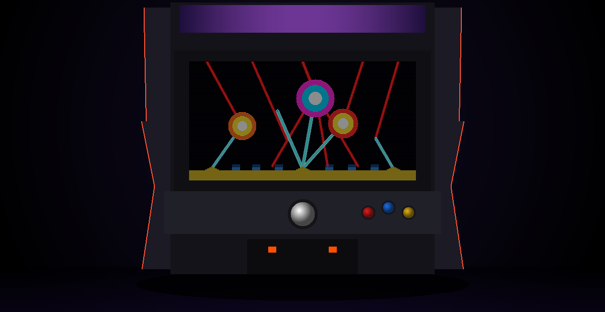

<div align="center">



# ⚡ MISSILE COMMAND ⚡

### *THE SKY IS FALLING. SIX CITIES STAND IN THE BALANCE.*

[](https://www.rust-lang.org)
[](https://github.com/scottdensmore/missile-command/actions)
[](https://github.com/scottdensmore/missile-command/releases)
[](LICENSE)
[](#--play-now)

<br/>

> ***"COMING AT YOU—WAVE AFTER RELENTLESS WAVE OF INTERCONTINENTAL BALLISTIC MISSILES, MIRV SPLITTERS, KILLER SATELLITES, AND EVASIVE SMART BOMBS. YOU ARE COMMANDER OF THREE ANTI-BALLISTIC MISSILE BATTERIES. WHEN THE SIREN SOUNDS, ONLY YOUR AIM STANDS BETWEEN CIVILIZATION AND 'THE END'."***

[🕹️ Play Now](#--play-now) • [🔥 Arcade Features](#--authentic-1980-arcade-engineering) • [🎯 Battle Controls](#--battle-controls--tactics) • [🌈 Wave Intelligence](#--threat-intelligence--scoring)

---

</div>

## 🔥 AUTHENTIC 1980 ARCADE ENGINEERING

Step back into 1980 and experience **Dave Theurer's** legendary Atari arcade masterpiece, recreated in pure **Rust** and [Macroquad](https://macroquad.rs/) with zero external audio files or sprite sheets. Every pixel, color cycle, and sound wave is synthesized in real time to match the original coin-op hardware:

| Arcade Subsystem | Hardware-Accurate Implementation |
| :--- | :--- |
| 🖥️ **256×231 CRT Raster & Phosphor Shader** | Native 256×231 arcade software framebuffer with aspect-ratio letterboxing, GLSL sinusoidal CRT scanlines, phosphor saturation bloom, and nuclear detonation screen flashes. |
| 🔊 **Atari POKEY 4-Channel Sound Chip** | Real-time 44.1 kHz synthesis of the CO-12294 POKEY chip—complete with 4-bit, 5-bit, and 17-bit LFSR polynomial noise rumbles, ABM launch whistles, klaxon sirens, and satellite telemetry. |
| 🚀 **Tri-Silo Tactical Defense** | Command **Alpha** (Left), **Delta** (Center), and **Omega** (Right) missile batteries. **Delta Base** fires high-velocity interceptors at **2.3× speed** (`7.5 px/frame`) for emergency low-altitude saves. |
| 🧠 **Smart Bomb Evasion AI** | Starting in Wave 6, spinning diamond **Smart Bombs** actively scan for expanding blast perimeters and steer around your explosions in real time. |
| ☄️ **MIRV Splitters & Orbital Fliers** | High-altitude warheads split into multiple independent targets mid-flight while **Bomber Aircraft** and **Killer Satellites** cross the sky dropping targeted payloads. |
| 🎨 **10-Stage Color RAM Cycling** | Original 20-wave arcade color lookup tables—shifting from midnight black skies to high-contrast cobalt, purple, yellow, stark white, and crimson alert palettes. |
| 🤖 **Live Attract Mode & AI Demo** | Classic arcade cabinet loop cycling between the **Great Scores** leaderboard and a live automated AI defense demonstration. |

---

## 🎯 BATTLE CONTROLS & TACTICS

```text
  [ ALPHA BASE (LEFT) ]            [ DELTA BASE (CENTER) ]            [ OMEGA BASE (RIGHT) ]
     10 Counter-Missiles             10 Counter-Missiles                10 Counter-Missiles
    Speed: 3.2 px / frame          Speed: 7.5 px / frame (FAST!)       Speed: 3.2 px / frame
```

<div align="center">

| Action | Mouse | Keyboard | Gamepad / Controller |
| :--- | :--- | :--- | :--- |
| **Insert Coin / Start** | `Left Click` | `Space` / `Enter` / `1` | `Start` / `A` / `Cross` |
| **Aim Crosshair** | `Mouse Move` | `Arrow Keys` | `Left Stick` / `D-Pad` |
| **Fire Alpha Base (Left)** | `Left Click` | `A` or `1` | `LB` / `LT` / `A` |
| **Fire Delta Base (Center - Fast)** | `Middle Click` | `Space` / `S` / `2` | `X` / `Y` |
| **Fire Omega Base (Right)** | `Right Click` | `D` or `3` | `RB` / `RT` / `B` |
| **Game Options Menu** | Click `O:OPTIONS` | `O` | `Select` / `Back` |
| **Toggle CRT Scanlines** | — | `F1` / `Tab` | — |
| **Toggle Fullscreen** | — | `F11` / `Alt+Enter` | — |
| **Mute / Volume** | — | `M` / `-` / `+` | — |
| **Pause / Quit** | — | `P` / `Q` / `Esc` | `Start` |

</div>

> [!TIP]
> **Commander's Field Manual:**
> 1. **Lead Your Targets:** Counter-missile explosions take time to expand. Aim ahead of descending ICBM trajectories and let the enemy fly into the expanding fireball.
> 2. **Chain Reactions:** Every enemy warhead destroyed inside an explosion detonates into its own secondary blast—use one well-placed shot to wipe out an entire MIRV cluster.
> 3. **Guard the Center Silo:** Save **Delta Base's** ultra-fast missiles for last-second city saves and evasive Smart Bombs.

---

## 🌈 THREAT INTELLIGENCE & SCORING

Points scale with your wave multiplier (**1×** on Waves 1–2 up to **6×** on Wave 11+). Every **10,000 points** awards a **Bonus City** in reserve to rebuild fallen cities between waves.

<div align="center">

| Hostile / Bonus | Base Value | 1× (W1–2) | 2× (W3–4) | 3× (W5–6) | 4× (W7–8) | 5× (W9–10) | 6× (W11+) |
| :--- | :---: | :---: | :---: | :---: | :---: | :---: | :---: |
| **ICBM Warhead** | `25` | 25 | 50 | 75 | 100 | 125 | **150** |
| **Bomber / Satellite** | `100` | 100 | 200 | 300 | 400 | 500 | **600** |
| **Smart Bomb** *(Wave 6+)* | `125` | 125 | 250 | 375 | 500 | 625 | **750** |
| **Unused Counter-Missile** | `5` | 5 | 10 | 15 | 20 | 25 | **30** |
| **Surviving City** | `100` | 100 | 200 | 300 | 400 | 500 | **600** |

</div>

---

## 🚀 PLAY NOW

### 1. Download Ready-to-Play Releases
Grab precompiled packages for your platform from the **[Releases Page](https://github.com/scottdensmore/missile-command/releases)**:
* 🍏 **macOS Universal (`Missile-Command-macOS-Universal.zip`)**: Native Apple Silicon & Intel `Missile Command.app` bundle with Retina squircle icon.
* 🪟 **Windows Installer & Portable (`Missile-Command-Setup-windows-amd64.exe` / `.zip`)**: Full setup wizard or standalone portable executable.
* 🐧 **Linux (`missile-command-linux-amd64.tar.gz`)**: Native binary with Freedesktop icons.
* 🌐 **WebAssembly (`missile-command-wasm.zip`)**: Play directly in any modern browser.

### 2. Build & Run from Source
Requires [Rust (stable toolchain)](https://rustup.rs/).

```bash
git clone https://github.com/scottdensmore/missile-command.git
cd missile-command

# Launch the arcade cabinet immediately
cargo run --release

# Run the full verification & test suite
cargo test

# Optional: Package a standalone macOS .app bundle or WebAssembly build
bash scripts/bundle-macos.sh
bash scripts/build-wasm.sh
```

> **Linux Dependencies:** If building from source on Ubuntu/Debian, install OpenGL, X11 & ALSA headers:
> `sudo apt-get install -y libgl1-mesa-dev libxi-dev libxcursor-dev libx11-dev libasound2-dev pkg-config`

---

## 🗂️ PROJECT STRUCTURE

```text
missile-command/
├── Cargo.toml           # Rust package manifest & dependencies
├── assets/              # Embedded window icons & arcade cabinet banner
├── src/
│   ├── main.rs          # Macroquad window loop, GLSL CRT material & audio runtime
│   ├── lib.rs           # Crate module exports for headless verification & tests
│   ├── game.rs          # State machine, wave lifecycle & tally logic
│   ├── simulation.rs    # Physics, MIRV splitting, smart bomb AI & collisions
│   ├── input.rs         # Mouse, keyboard, gamepad controls & attract mode AI
│   ├── options.rs       # In-game configuration menu
│   ├── render.rs        # 256×231 playfield, HUD & screen rendering
│   ├── framebuffer.rs   # Pure-Rust 256×231 RGBA rasterizer
│   ├── pipeline.rs      # Aspect-ratio letterboxer & GLSL CRT scanline shader
│   ├── audio.rs         # Real-time 4-channel Atari POKEY sound synthesizer
│   ├── palette.rs       # 10 arcade wave color RAM tables & explosion cycling
│   ├── sprites.rs       # 8×8 bitmap font & pixel-art entity sprites
│   ├── objects.rs       # Entity data structures & arcade wave progression table
│   ├── scores.rs        # Top 10 leaderboard & user config persistence
│   ├── settings.rs      # Persistent user settings
│   ├── math.rs          # 2D vector math & coordinate space transforms
│   ├── assets.rs        # Embedded multi-resolution window icon decoder
│   └── bin/
│       └── generate_icons.rs # Multi-platform icon generator (.icns, .ico, PNGs)
├── tests/
│   └── game_tests.rs    # Comprehensive integration & unit verification suite
├── scripts/             # macOS .app, Windows installer & WASM packaging scripts
└── web/                 # Retro HTML5 / WebAssembly runner
```

---

<div align="center">

*Originally created by **Dave Theurer** at Atari, Inc. (1980).*  
*Released under the [MIT License](LICENSE). Missile Command is a registered trademark of Atari Interactive, Inc.*

</div>
